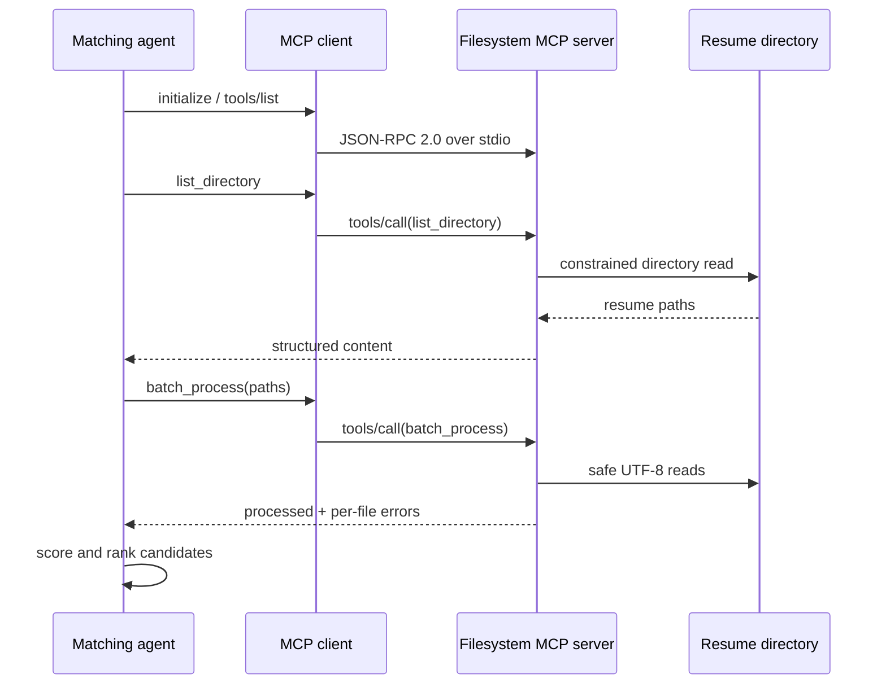

# MCP resume matching assignment

`filesystem_mcp_server.py` is a stdio Model Context Protocol server. It speaks JSON-RPC 2.0 and exposes filesystem content as MCP resources plus six tools: listing, reading, metadata, searching, `watch_directory`, and fault-tolerant `batch_process`.

The server confines every resolved path to `--root`, sets a file-size limit, returns structured JSON-RPC errors, and does not emit log noise on stdout.

`matching_agent.py` contains no direct filesystem calls for resume discovery or reading. Its `McpClient` launches the server and the agent calls `list_directory` and `batch_process` over MCP before scoring resumes locally.

## Workflow



## Run

```bash
python filesystem_mcp_server.py --root ./resumes
python matching_agent.py "Python SQL engineer" --root ./resumes
python -m unittest -v
```

## Test scenarios

The tests cover protocol/resource discovery and resource reads; per-item batch errors plus directory-traversal prevention; and the complete agent-to-server batch ranking workflow.

## Multi-MCP bonus extension

`McpClient` is deliberately transport-focused. Instantiate a second client for a web-search or database MCP server, use that server's `tools/list` to discover its interface, then merge its returned job/context data with the filesystem batch results before scoring. This keeps integration at the agent layer rather than reintroducing custom tool code.
